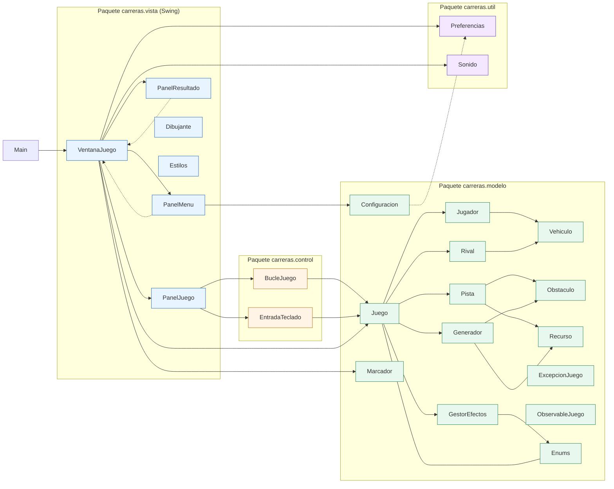
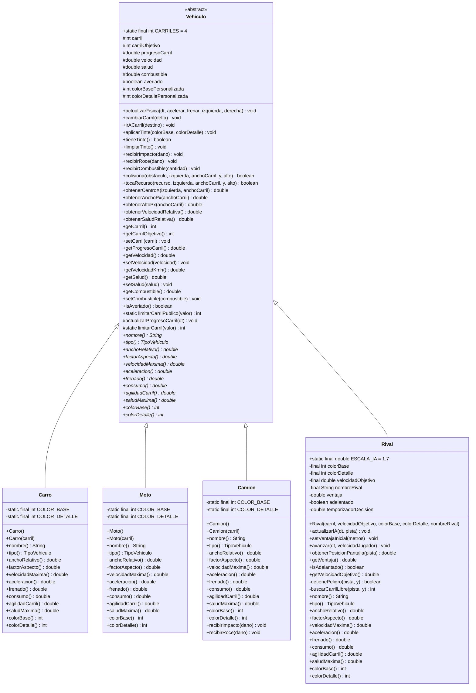
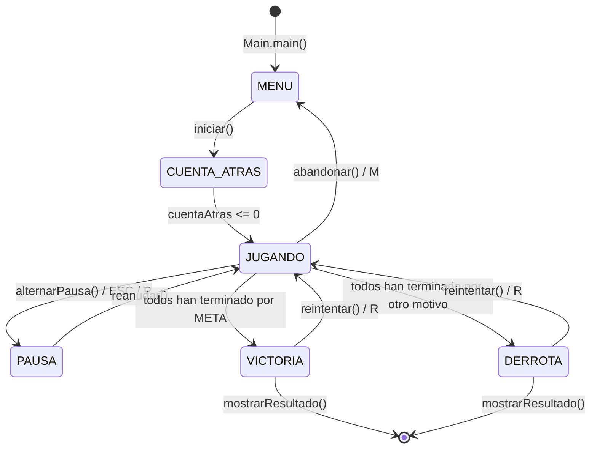
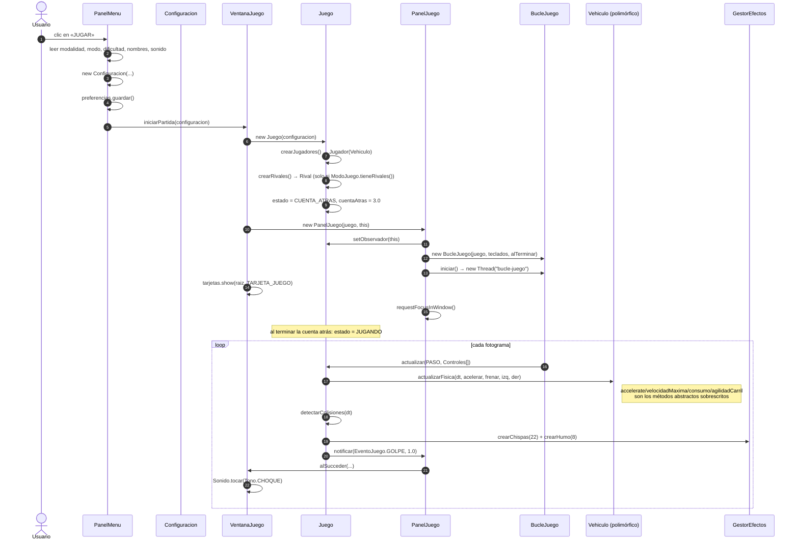

# Diagramas UML — Gran Rally Turbo

Documento generado a partir del código fuente de `src/carreras` (37 archivos `.java`).
Los diagramas están escritos en **Mermaid** para visualizarse directamente en GitHub,
GitLab, VS Code (extensión *Markdown Preview Mermaid Support*) o en
[mermaid.live](https://mermaid.live).

Las **fuentes en PlantUML** de los mismos diagramas están en
[`diagramas/`](diagramas/) y se pueden renderizar en <https://www.plantuml.com/plantuml/uml>.

---

## 1. Mapa general de paquetes



### Dependencias entre paquetes (sentido de la flecha: «usa»)

| Origen | Destino | Detalle |
|---|---|---|
| `carreras` | `carreras.vista` | `Main` crea `VentanaJuego` y la muestra. |
| `carreras.vista` | `carreras.modelo`, `carreras.control`, `carreras.util` | La vista lee el modelo, lanza el bucle y reproduce sonidos. |
| `carreras.control` | `carreras.modelo` | `BucleJuego` actualiza `Juego`; `EntradaTeclado` crea `Controles`. |
| `carreras.modelo` | `carreras.util` | `Configuracion` recibe `Preferencias`. |
| `carreras.modelo` | `java.awt.Color` | Colores de conos, recursos y efectos. |

> Regla aplicada: **el modelo nunca importa a la vista**. El flujo de información va en un
> solo sentido (vista → modelo) y los retornos de eventos viajan por `ObservableJuego`.

---

## 2. Jerarquía de vehículos (herencia)



`*` = método abstracto que la subclase está obligada a implementar.

### Particularidades relevantes

| Clase | Detalle |
|---|---|
| `Vehiculo` | Constructores **protegidos**: solo las subclases pueden instanciarla. |
| `Camion` | Única subclase que sobrescribe además `recibirImpacto` y `recibirRoce` (reduce el daño un 30 %). |
| `Rival` | Sus atributos `colorBase`/`colorDetalle` comparten nombre con los métodos abstractos `colorBase()`/`colorDetalle()`; los métodos devuelven el atributo. |
| `Rival` | `tipo()` devuelve `TipoVehiculo.CARRO`, por lo que la PC se dibuja como un carro aunque sea una clase propia. |
| `Rival` | `consumo()` devuelve `0.0`: los rivales no gastan combustible. |

---

## 3. Núcleo del modelo

```mermaid
classDiagram
    direction TB

    class Juego {
        -static final double ANCHO_INICIAL
        -static final double ALTO_INICIAL
        -static final double PUNTOS_POR_METRO
        -static final double DANO_CONO
        -static final double VELOCIDAD_BASE_PC
        -static final double VELOCIDAD_POR_DIFICULTAD
        -static final double PENALIZACION_GOLPE
        -final Configuracion configuracion
        -final List~Jugador~ jugadores
        -final Pista pista
        -final Generador generador
        -final GestorEfectos efectos
        -final List~Rival~ rivales
        -final double[] distancias
        -final boolean[] finalizadoPorJugador
        -final CausaFin[] causaPorJugador
        -EstadoJuego estado
        -CausaFin causaFin
        -boolean finalizada
        -double tiempo
        -double cuentaAtras
        -double sacudida
        -double[] ultimoGolpe
        -ObservableJuego observador
        +Juego(configuracion)
        +setObservador(observador) void
        +iniciar() void
        +actualizar(dt, acelerar, frenar, izquierda, derecha) void
        +actualizar(dt, controles) void
        +pausar() void
        +reanudar() void
        +alternarPausa() void
        +abandonar() void
        +redimensionar(ancho, alto) void
        +getJugadores() List~Jugador~
        +getNumeroJugadores() int
        +esMultijugador() boolean
        +getJugador() Jugador
        +getJugador(indice) Jugador
        +getVehiculo() Vehiculo
        +getVehiculo(indice) Vehiculo
        +getPista() Pista
        +getGenerador() Generador
        +getEfectos() GestorEfectos
        +getConfiguracion() Configuracion
        +getRivales() List~Rival~
        +getClasificacion() List~Rival~
        +getDistancia(indice) double
        +getDistanciaMeta() double
        +getProgreso(indice) double
        +getProgresoLeader() double
        +getPuesto(indice) int
        +getTotalCompetidores() int
        +getNumeroRivales() int
        +getNombreRival(indice) String
        +getDistanciaRival(indice) double
        +getPuestoRival(indice) int
        +getVelocidadRival(indice) double
        +rivalTermino(indice) boolean
        +getMeta() double
        +getTiempo() double
        +getPuntos(indice) double
        +getPuntosEnteros(indice) int
        +getCuentaAtras() double
        +getSacudida() double
        +getEstado() EstadoJuego
        +getCausaFin(indice) CausaFin
        +isFinalizado(indice) boolean
        -crearJugadores() void
        -distinguirJugadores() void
        -crearRivales() void
        -notificar(evento, intensidad) void
        -controlesDe(indice, controles) Controles
        -validarDelta(dt) double
        -ejecutarSimulacion(dt, controles) void
        -distanciaMedia() double
        -actualizarRivales(dt) void
        -velocidadLeader() double
        -detectarColisiones(dt) void
        -recogerRecursos() void
        -actualizarEfectosAmbientales() void
        -calcularPuntuacion(dt) void
        -factorPuntuacion(indice) double
        -evaluarJugador(indice) CausaFin
        -comprobarFin() void
        -finalizarJugador(indice, causa) void
        -todosFinalizados() boolean
        -causaGlobal() CausaFin
        -finalizar(causa) void
    }

    class Jugador {
        -final Vehiculo vehiculo
        -final String nombrePiloto
        -final int numero
        -double puntos
        -int racha
        -int mejorRacha
        -int golpesRecibidos
        -int adelantamientos
        -int recursos
        +Jugador(vehiculo, nombrePiloto)
        +Jugador(vehiculo, nombrePiloto, numero)
        +getNumero() int
        +getEtiqueta() String
        +getVehiculo() Vehiculo
        +getNombrePiloto() String
        +sumarRacha(cantidad) void
        +registrarImpacto(dano) void
        +registrarAdelantamiento() void
        +registrarRecurso() void
        +sumarPuntos(cantidad) void
        +getPuntos() double
        +getRacha() int
        +getMejorRacha() int
        +getGolpesRecibidos() int
        +getAdelantamientos() int
        +getRecursos() int
        +getCarril() int
        +getVelocidad() double
        +getVelocidadKmh() double
        +getSalud() double
        +getCombustible() double
        +obtenerVelocidadRelativa() double
        +obtenerCentroX(izquierda, anchoCarril) double
        +obtenerAnchoPx(anchoCarril) double
        +obtenerAltoPx(anchoCarril) double
        +isAveriado() boolean
        +nombreVehiculo() String
    }

    class Pista {
        +static final double ESCALA
        -final List~Obstaculo~ obstaculos
        -final List~Recurso~ recursos
        -double desplazamiento
        -double anchoVista
        -double altoVista
        -double anchoCarril
        -double anchura
        -double izquierda
        -long obstaculosGenerados
        -long recursosGenerados
        +Pista(anchoVista, altoVista)
        +redimensionar(ancho, alto) void
        +actualizar(dt, velocidadJugador) void
        +agregarObstaculo(obstaculo) void
        +agregarRecurso(recurso) void
        +limpiar() void
        +carrilOcupado(carril, desde, hasta) boolean
        +carrilesLibres(desde, hasta) int
        +getPosicionJugador() double
        +getPosicionJugador(indice) double
        +getObstaculos() List~Obstaculo~
        +getRecursos() List~Recurso~
        +getDesplazamiento() double
        +getAnchoCarril() double
        +getAnchura() double
        +getIzquierda() double
        +getAnchoVista() double
        +getAltoVista() double
        +getObstaculosGenerados() long
        +getRecursosGenerados() long
    }

    class Generador {
        -static final double APARICION_CIMA
        -final Pista pista
        -final Dificultad dificultad
        -final ModoJuego modo
        -double temporizadorObstaculo
        -double temporizadorRecurso
        -double dificultadDinamica
        +Generador(pista, dificultad, modo)
        +actualizar(dt, velocidadJugador, distancia) void
        +getDificultadDinamica() double
        -calcularIntervalo() double
        -generarObstaculo() void
        -generarRecurso() void
        -elegirCarrilLibre() int
        -elegirCarrilLibre(excepto) int
    }

    class Obstaculo {
        -static final double VELOCIDAD_PROPIA
        -static final double ANCHO_RELATIVO
        -static final double FACTOR_ASPECTO
        -final int carril
        -final int colorBase
        -final int colorDetalle
        -final double anchoRelativo
        -final double factorAspecto
        -double posicionY
        -boolean activo
        -Obstaculo(carril, colorBase, colorDetalle, posicionY)
        +static crearCono(carril, posicionY) Obstaculo
        +avanzar(dt, velocidadJugador) void
        +haSalido(altoVista) boolean
        +golpear() void
        +obtenerCentroX(izquierda, anchoCarril) double
        +obtenerAnchoPx(anchoCarril) double
        +obtenerAltoPx(anchoCarril) double
        +getCarril() int
        +getPosicionY() double
        +setPosicionY(posicionY) void
        +estaActivo() boolean
        +obtenerColorBase() Color
        +obtenerColorDetalle() Color
        +getAnchoRelativo() double
        +getFactorAspecto() double
    }

    class Recurso {
        -final int carril
        -double posicionY
        -double animacion
        -boolean activo
        +Recurso(carril, posicionY)
        +avanzar(dt, velocidadJugador) void
        +haSalido(altoVista) boolean
        +recolectar() void
        +obtenerCentroX(izquierda, anchoCarril) double
        +getCarril() int
        +getPosicionY() double
        +getAnimacion() double
        +estaActivo() boolean
    }

    class GestorEfectos {
        -static final int MAXIMO = 260
        -final List~Efecto~ efectos
        +crearChispas(x, y, cantidad, color) void
        +crearHumo(x, y, cantidad) void
        +crearResplandor(x, y, color, intensidad) void
        +actualizar(dt) void
        +limpiar() void
        +getEfectos() List~Efecto~
        -recortar() void
    }

    class Efecto {
        -final double x
        -final double y
        -final double vx
        -final double vy
        -double vida
        -final double vidaMaxima
        -final double tamano
        -final Color color
        -final boolean gravedad
        +Efecto(x, y, vx, vy, vida, tamano, color, gravedad)
        +avanzar(dt) void
        +estaVivo() boolean
        +getAlfa() float
        +getX() double
        +getY() double
        +getVx() double
        +getVy() double
        +getTamano() double
        +getColor() Color
        +isGravedad() boolean
    }

    class Configuracion {
        +static final int LONGITUD_MAXIMA_NOMBRE = 16
        -final TipoVehiculo tipoVehiculo
        -final TipoVehiculo tipoVehiculo2
        -final ModoJuego modo
        -final Modalidad modalidad
        -final Dificultad dificultad
        -final boolean sonido
        -final String nombrePiloto
        -final String nombrePiloto2
        +Configuracion(tipo, modo, dificultad, sonido, nombre)
        +Configuracion(tipo, tipo2, modo, modalidad, dificultad, sonido, nombre, nombre2)
        +static desdePreferencias(preferencias) Configuracion
        +crearVehiculo() Vehiculo
        +crearVehiculo(indice) Vehiculo
        +getNombrePiloto(indice) String
        +resumen() String
        +getTipoVehiculo() TipoVehiculo
        +getTipoVehiculo2() TipoVehiculo
        +getModo() ModoJuego
        +getModalidad() Modalidad
        +getDificultad() Dificultad
        +isSonido() boolean
        +getNombrePiloto() String
        +getNombrePiloto2() String
        -validarNombre(nombre, indice) void
    }

    class Marcador {
        -static final String NOMBRE_ARCHIVO
        -final Path archivo
        -final Map~String,Integer~ mejores
        -final Map~String,String~ pilotos
        +Marcador()
        +Marcador(archivo)
        +cargar() void
        +guardar() void
        +registrar(modo, puntos, piloto) boolean
        +getMejor(modo) int
        +getPiloto(modo) String
        +reiniciar() void
        +getMejores() Map~String,Integer~
        -cerrar(lector) void
        -cerrarEscritor(escritor) void
    }

    class Controles {
        +static final Controles NADA
        -final boolean acelerar
        -final boolean frenar
        -final boolean carrilIzquierda
        -final boolean carrilDerecha
        +Controles(acelerar, frenar, carrilIzquierda, carrilDerecha)
        +isAcelerar() boolean
        +isFrenar() boolean
        +isCarrilIzquierda() boolean
        +isCarrilDerecha() boolean
        +estaQuieto() boolean
    }

    class ExcepcionJuego {
        -static final long serialVersionUID
        +ExcepcionJuego(mensaje)
        +ExcepcionJuego(mensaje, causa)
    }

    class ObservableJuego {
        <<interface>>
        +alSucceder(evento, intensidad) void
    }

    class Modalidad {
        <<enumeration>>
        DOS_JUGADORES
        CONTRA_PC
        EQUIPO_VS_PC
        +getEtiqueta() String
        +getDescripcion() String
        +getJugadoresHumanos() int
        +getRivales() int
        +esDuo() boolean
        +tieneRivales() boolean
        +getTeclas() String
        +static desdeNombre(nombre) Modalidad
    }

    class ModoJuego {
        <<enumeration>>
        CARRERA
        INFINITO
        +getEtiqueta() String
        +getDescripcion() String
        +getDistanciaMeta() double
        +esInfinito() boolean
        +tieneRivales() boolean
        +calcularDificultad(distancia) double
        +static desdeNombre(nombre) ModoJuego
    }

    class Dificultad {
        <<enumeration>>
        FACIL
        NORMAL
        DIFICIL
        +getEtiqueta() String
        +getDescripcion() String
        +getFactorDensidad() double
        +getFactorVelocidad() double
        +getFactorPuntuacion() double
        +static desdeNombre(nombre) Dificultad
    }

    class TipoVehiculo {
        <<enumeration>>
        CARRO
        MOTO
        CAMION
        +getEtiqueta() String
        +getDescripcion() String
        +getFactorPuntuacion() double
        +crear() Vehiculo
        +static desdeNombre(nombre) TipoVehiculo
    }

    class EstadoJuego {
        <<enumeration>>
        MENU
        CUENTA_ATRAS
        JUGANDO
        PAUSA
        VICTORIA
        DERROTA
    }

    class EventoJuego {
        <<enumeration>>
        GOLPE
        RECOLECTADO
        ADELANTAMIENTO
        VICTORIA
        DERROTA
        CUENTA_ATRAS
        SALTO
    }

    class CausaFin {
        <<enumeration>>
        META
        FALLO_MECANICO
        SIN_COMBUSTIBLE
        ABANDONO
        ERROR_INTERNO
        +getDescripcion() String
    }

    Juego o-- Configuracion
    Juego *-- Jugador
    Juego *-- Pista
    Juego *-- Generador
    Juego *-- GestorEfectos
    Juego o-- Rival
    Juego ..> Controles
    Juego ..> ObservableJuego
    Jugador *-- Vehiculo
    Pista *-- Obstaculo
    Pista *-- Recurso
    Generador --> Pista
    Generador ..> Obstaculo
    Generador ..> Recurso
    GestorEfectos *-- Efecto
    Configuracion ..> TipoVehiculo
    Configuracion ..> ModoJuego
    Configuracion ..> Modalidad
    Configuracion ..> Dificultad
    Configuracion ..> Vehiculo
    TipoVehiculo ..> Vehiculo
    Vehiculo ..> Obstaculo
    Vehiculo ..> Recurso
    Rival --> Pista
    ExcepcionJuego <|-- Exception
    ObservableJuego <|-- PanelJuego
    ObservableJuego <|-- VentanaJuego
```



> Los tipos genéricos se escriben con `~T~` por compatibilidad con Mermaid.

### Enumeraciones y valores reales

| Enum | Constante | Datos asociados |
|---|---|---|
| `Modalidad` | `DOS_JUGADORES` | 2 humanos, 0 rivales |
| | `CONTRA_PC` | 1 humano, 1 rival |
| | `EQUIPO_VS_PC` | 2 humanos, 1 rival |
| `ModoJuego` | `CARRERA` | meta `3500.0` m, sin crecimiento, `tieneRivales = true` |
| | `INFINITO` | meta `Double.MAX_VALUE`, crecimiento `0.00055`, `tieneRivales = false` |
| `Dificultad` | `FACIL` | densidad `0.65`, velocidad `0.82`, puntos `0.75` |
| | `NORMAL` | `1.0 / 1.0 / 1.0` |
| | `DIFICIL` | `1.45 / 1.22 / 1.4` |
| `TipoVehiculo` | `CARRO`, `MOTO`, `CAMION` | factor de puntuación por tipo |
| `EstadoJuego` | `MENU`, `CUENTA_ATRAS`, `JUGANDO`, `PAUSA`, `VICTORIA`, `DERROTA` | — |
| `EventoJuego` | `GOLPE`, `RECOLECTADO`, `ADELANTAMIENTO`, `VICTORIA`, `DERROTA`, `CUENTA_ATRAS`, `SALTO` | `SALTO` está declarado pero nunca se emite |
| `CausaFin` | `META`, `FALLO_MECANICO`, `SIN_COMBUSTIBLE`, `ABANDONO`, `ERROR_INTERNO` | texto descriptivo |

---

## 4. Vista y control

```mermaid
classDiagram
    direction TB

    class VentanaJuego {
        -static final String TARJETA_MENU
        -static final String TARJETA_JUEGO
        -static final String TARJETA_RESULTADO
        -final CardLayout tarjetas
        -final JPanel raiz
        -final PanelMenu menu
        -final PanelResultado resultado
        -final Marcador marcador
        -final Preferencias preferencias
        -PanelJuego panelJuego
        -Configuracion configuracionActual
        -boolean sonidoActivo
        -Timer temporizadorResultado
        +VentanaJuego()
        +getJuegoActual() Juego
        +iniciarPartida(configuracion) void
        +reintentar() void
        +mostrarMenu() void
        +mostrarResultado() void
        +getRecordDe(juego, indice) int
        +borrarRecords() void
        +getRecords() int[]
        +reproducirEvento(evento) void
        +instalarAtajosGlobales() void
        +alSucceder(evento, intensidad) void
        -claveRecord(juego, indice) String
        -programarResultado() void
        -mostrarError(mensaje) void
        -detenerPartida() void
        -cerrar() void
        -configuracionPorDefecto() Configuracion
    }

    class PanelMenu {
        -static final int H_CARDS
        -static final int H_OPCION
        -static final int H_MODALIDAD
        -static final int H_CAMPO
        -static final int H_BOTON
        -static final int SEPARACION
        -final VentanaJuego ventana
        -final Preferencias preferencias
        -final TarjetaVehiculo[] tarjetas
        -final Opcion[] opcionesModalidad
        -final Opcion[] opcionesVehiculo2
        -final Opcion[] opcionesModo
        -final Opcion[] opcionesDificultad
        -final JTextField campoPiloto
        -final JTextField campoPiloto2
        -final JCheckBox casillaSonido
        -final JLabel etiquetaError
        -final BotonPersonalizado botonJugar
        -final BotonPersonalizado botonBorrar
        -int yTarjetas
        -int yModalidad
        -int yVehiculo2
        -int yModo
        -int yDificultad
        -int yNombres
        +PanelMenu(ventana, preferencias)
        +paintComponent(g) void
        +modalidadSeleccionada() Modalidad
        +vehiculoSeleccionado() TipoVehiculo
        +vehiculo2Seleccionado() TipoVehiculo
        +modoSeleccionado() ModoJuego
        +dificultadSeleccionada() Dificultad
        -modalidadGuardada() Modalidad
        -crearCampoTexto() JTextField
        -crearTarjetasVehiculo() void
        -crearOpcionesModalidad() void
        -crearOpcionesVehiculo2() void
        -crearOpcionesModo() void
        -crearOpcionesDificultad() void
        -reorganizar() void
        -seleccionarModalidad(modalidad) void
        -seleccionarVehiculo2(tipo) void
        -seleccionarTarjeta(tarjeta) void
        -iniciarPartida() void
        -mostrarError(mensaje) void
        -ocultarError() void
        -seccion(g, titulo, y) void
        -dibujarMarcador(g) void
    }

    class PanelJuego {
        -static final Color[] COLORES_JUGADOR
        -final Juego juego
        -final VentanaJuego ventana
        -final List~EntradaTeclado~ teclados
        -BucleJuego bucle
        -double faseRuedas
        +PanelJuego(juego, ventana)
        +iniciar() void
        +getJuego() Juego
        +getTeclados() List~EntradaTeclado~
        +detener() void
        +addNotify() void
        +paintComponent(g) void
        +alSucceder(evento, intensidad) void
        -manejarTecla(codigo) void
        -limpiarTeclados() void
        -dibujarEscena(g) void
        -dibujarObjeto(g, objeto) void
        -dibujarEtiquetaJugador(g, jugador, x, y) void
        -dibujarHud(g) void
        -dibujarPanelJugador(g, x, y, ancho, alto) void
        -recortar(texto) String
        -dibujarAvisos(g) void
        -nombresPilotos() String
        -formatearTiempo(segundos) String
    }

    class PanelResultado {
        -static final Color[] COLORES_JUGADOR
        -final VentanaJuego ventana
        -Juego juego
        -boolean nuevoRecord
        +PanelResultado(ventana)
        +mostrar(juego, nuevoRecord) void
        +getJuego() Juego
        +paintComponent(g) void
        -dibujarPc(g) void
        -recordDe(indice) int
        -dibujarJugador(g, x, y, ancho, alto) void
        -fila(g, x, y, etiqueta, valor) void
        -formatearTiempo(segundos) String
    }

    class BucleJuego {
        +static final int FOTOGRAMAS = 60
        +static final double PASO
        -final Juego juego
        -final List~EntradaTeclado~ teclados
        -final Runnable alTerminar
        -final List~Runnable~ alPintar
        -volatile boolean activo
        -volatile boolean terminado
        -Thread hilo
        +BucleJuego(juego, teclado, alTerminar)
        +BucleJuego(juego, teclados, alTerminar)
        +addAlPintar(accion) void
        +iniciar() void
        +detener() void
        +isActivo() boolean
        +getNumeroTeclados() int
        +isTerminado() boolean
        +run() void
        -leerControles() Controles[]
        -pintar() void
    }

    class EntradaTeclado {
        -final int[] teclasAcelerar
        -final int[] teclasFrenar
        -final int[] teclasCarrilIzquierda
        -final int[] teclasCarrilDerecha
        -final String etiqueta
        -final Set~Integer~ teclas
        -final Set~Integer~ pulsacionesNuevas
        +EntradaTeclado()
        +EntradaTeclado(acelerar, frenar, izquierda, derecha, etiqueta)
        +static jugadorUno() EntradaTeclado
        +static jugadorDos() EntradaTeclado
        +keyPressed(evento) void
        +keyReleased(evento) void
        +keyTyped(evento) void
        +getEtiqueta() String
        +acelerar() boolean
        +frenar() boolean
        +izquierda() boolean
        +derecha() boolean
        +tomarCarrilIzquierda() boolean
        +tomarCarrilDerecha() boolean
        +pausa() boolean
        +salir() boolean
        +reiniciar() boolean
        +soltar(codigo) void
        +limpiar() void
        +getTeclasPulsadas() int
        -algunaTeclaPulsada(codigos) boolean
        -tomarPulsacion(codigos) boolean
        -pulsada(codigo) boolean
    }

    class Dibujante {
        +static paisaje(g, ancho, alto, distancia, velocidadRelativa) void
        +static carretera(g, pista, distancia, hayMeta) void
        +static sombra(g, x, y, ancho, alto) void
        +static vehiculo(g, vehiculo, pista, y, faseRuedas, faros) void
        +static carro(g, x, y, ancho, alto, base, detalle, fase, faros) void
        +static moto(g, x, y, ancho, alto, base, detalle, faros) void
        +static camion(g, x, y, ancho, alto, base, detalle, faros) void
        +static obstaculo(g, obstaculo, pista) void
        +static recurso(g, recurso, pista) void
        +static efecto(g, efecto) void
        +static vistaPrevia(g, tipo, x, y, ancho, alto) void
        -dibujarSol(g, x, y, r) void
        -dibujarNubes(g, ancho, alto, desplazamiento) void
        -dibujarMontanas(g, ancho, alto, desplazamiento, ...) void
        -dibujarBordeVerde(g, pista, alto, desplazamiento) void
        -dibujarDecoracion(g, pista, alto, desplazamiento, distancia) void
        -dibujarObjetoBorde(g, x, y, escala, tipo) void
        -dibujarMeta(g, pista, alto) void
        -ruedas(g, x, y, ancho, alto, fase, pares) void
        -cono(g, x, y, ancho, alto) void
        -faros(g, x, y, ancho, faros) void
    }

    class Estilos {
        +static final int ANCHO = 940
        +static final int ALTO = 800
        +static final Color
        +static final Font
        +static suavizar(g) void
        +static degradadoVertical(x, y, alto, arriba, abajo) GradientPaint
        +static panel(g, x, y, ancho, alto, radio, color, alfa) void
        +static texto(g, texto, fuente, color, x, y) void
        +static textoCentro(g, texto, fuente, color, x, y) void
        +static textoDerecha(g, texto, fuente, color, x, y) void
        +static barra(g, x, y, ancho, alto, proporcion, color) void
        +static boton(texto, fondo, colorTexto) JButton
    }

    class TarjetaVehiculo {
        -static final String[] ETIQUETAS
        -final TipoVehiculo tipo
        -final double[] estadisticas
        -boolean seleccionada
        -boolean sobre
        +TarjetaVehiculo(tipo)
        +getTipo() TipoVehiculo
        +isSeleccionada() boolean
        +setSeleccionada(seleccionada) void
        +setSobre(sobre) void
        +paintComponent(g) void
        -static calcularEstadisticas(tipo) double[]
    }

    class Opcion {
        -final String titulo
        -final String descripcion
        -final Runnable accion
        -boolean seleccionada
        -boolean sobre
        +Opcion(titulo, descripcion, accion)
        +seleccionar() void
        +getTitulo() String
        +isSeleccionada() boolean
        +setSeleccionada(seleccionada) void
        +setSobre(sobre) void
        +paintComponent(g) void
    }

    class BotonPersonalizado {
        -final String titulo
        -final Color fondo
        -final Color colorTexto
        -boolean sobre
        +BotonPersonalizado(titulo, fondo, colorTexto)
        +setSobre(sobre) void
        +paintComponent(g) void
    }

    class RatonOpcion {
        -final Opcion opcion
        +RatonOpcion(opcion)
        +mousePressed(evento) void
        +mouseEntered(evento) void
        +mouseExited(evento) void
    }

    class RatonBoton {
        -final BotonPersonalizado boton
        -final Runnable accion
        +RatonBoton(boton, accion)
        +mousePressed(evento) void
        +mouseEntered(evento) void
        +mouseExited(evento) void
    }

    class Raton {
        -final BotonPersonalizado boton
        -final Runnable accion
        +Raton(boton, accion)
        +mousePressed(evento) void
        +mouseEntered(evento) void
        +mouseExited(evento) void
    }

    class Dibujable {
        -final double y
        -final Object objeto
        +Dibujable(y, objeto)
        +getY() double
        +getObjeto() Object
    }

    class Preferencias {
        -final Path archivo
        -final Properties propiedades
        -boolean guardadas
        +Preferencias(archivo)
        +cargar() void
        +guardar() void
        +get(clave, valorPorDefecto) String
        +set(clave, valor) void
        +getEntero(clave, valorPorDefecto) int
        +setEntero(clave, valor) void
        +isGuardadas() boolean
    }

    class Sonido {
        -static final float TAXA
        -static boolean disponible
        +static tocar(tono) void
        +static pitido() void
        +static generarMuestra(tono) byte[]
        +static isDisponible() boolean
        -static reproducir(clip, tono) void
        -static cerrar(clip) void
    }

    class Tono {
        <<enumeration>>
        CLIC
        CHOQUE
        RECOLECTAR
        ADELANTAR
        CUENTA_ATRAS
        VICTORIA
        DERROTA
        +getFrecuencia() double
        +getDuracion() double
        +getVolumen() double
        +isAgudo() boolean
    }

    class Main {
        +static main(args) void
        -static aplicarEstilo() void
        -static error(mensaje) void
    }

    Main ..> VentanaJuego
    VentanaJuego o-- PanelMenu
    VentanaJuego o-- PanelResultado
    VentanaJuego o-- PanelJuego
    VentanaJuego --> Marcador
    VentanaJuego --> Preferencias
    VentanaJuego ..> Juego
    VentanaJuego ..> Sonido
    VentanaJuego ..> Tono
    VentanaJuego o-- CardLayout
    PanelMenu --> VentanaJuego
    PanelMenu o-- TarjetaVehiculo
    PanelMenu o-- Opcion
    PanelMenu o-- BotonPersonalizado
    PanelMenu ..> RatonOpcion
    PanelMenu ..> RatonBoton
    PanelMenu ..> Configuracion
    PanelMenu --> Preferencias
    TarjetaVehiculo --> TipoVehiculo
    TarjetaVehiculo ..> Dibujante
    TarjetaVehiculo ..> Estilos
    Opcion --> Runnable
    BotonPersonalizado --> Estilos
    PanelJuego o-- BucleJuego
    PanelJuego --> EntradaTeclado
    PanelJuego --> Juego
    PanelJuego --> VentanaJuego
    PanelJuego o-- Dibujable
    PanelJuego ..> Dibujante
    PanelJuego ..> Estilos
    PanelJuego ..> Runnable
    PanelJuego ..> Comparator
    PanelResultado --> VentanaJuego
    PanelResultado ..> VentanaJuego
    PanelResultado ..> PanelMenu
    PanelResultado ..> Estilos
    BucleJuego --> Juego
    BucleJuego --> EntradaTeclado
    BucleJuego ..> Controles
    BucleJuego --> Runnable
    EntradaTeclado <|-- KeyListener
    BucleJuego <|-- Runnable
    Sonido *-- Tono
```



### Clases internas (anidadas)

| Clase externa | Clase interna | Visibilidad | Hereda de | Rol |
|---|---|---|---|---|
| `PanelMenu` | `TarjetaVehiculo` | `static final` (paquete) | `JComponent` | Tarjeta seleccionable de vehículo con vista previa y 3 barras de estadística. |
| `PanelMenu` | `Opcion` | `static final` (paquete) | `JComponent` | Opción genérica con título, descripción y `Runnable` de acción. |
| `PanelMenu` | `BotonPersonalizado` | `static final` (paquete) | `JComponent` | Botón dibujado a medida, reutilizado por `PanelResultado`. |
| `PanelMenu` | `RatónBoton` | `private static final` | `MouseAdapter` | Listener reutilizable de botón con efecto *hover*. |
| `PanelMenu` | `RatónOpcion` | `private static final` | `MouseAdapter` | Listener de las opciones del menú. |
| `PanelJuego` | `Dibujable` | `private static final` | — | Par `(ordenY, objeto)` para ordenar el dibujado por profundidad. |
| `PanelResultado` | `Raton` | `private static final` | `MouseAdapter` | Listener de los botones de resultado. |
| `Sonido` | `Tono` | `public enum` | — | Tonos sintetizados (frecuencia, duración, volumen, agudo). |

---

## 5. Patrón Observer

```mermaid
classDiagram
    direction LR
    class Juego {
        -ObservableJuego observador
        +setObservador(observador) void
        -notificar(evento, intensidad) void
    }
    interface ObservableJuego {
        +alSucceder(evento, intensidad) void
    }
    class PanelJuego {
        +alSucceder(evento, intensidad) void
    }
    class VentanaJuego {
        +alSucceder(evento, intensidad) void
    }
    class Sonido {
        +static tocar(tono) void
    }

    Juego --> ObservableJuego : observador
    ObservableJuego <|.. PanelJuego
    ObservableJuego <|.. VentanaJuego
    PanelJuego ..> VentanaJuego : delega
    VentanaJuego ..> Sonido
```

Cadena real de eventos:

```
Juego.notificar(EventoJuego.GOLPE, 1.0)
        └─> PanelJuego.alSucceder(GOLPE, 1.0)
                └─> VentanaJuego.alSucceder(GOLPE, 1.0)
                        ├─> Sonido.tocar(Sonido.Tono.CHOQUE)
                        └─> (según evento) iniciar temporizador de resultado
```

`Juego` no conoce ninguna clase de Swing: solo la interfaz `ObservableJuego`.

---

## 6. Máquina de estados de la partida



Transiciones implementadas en `Juego.actualizar`, `Juego.alternarPausa`,
`Juego.abandonar`, `Juego.finalizar` y `Juego.evaluarJugador`.

---

## 7. Secuencia: bucle de juego (60 FPS)

```mermaid
sequenceDiagram
    autonumber
    participant U as Usuario (teclado)
    participant E as EntradaTeclado
    participant B as BucleJuego (hilo daemon)
    participant J as Juego
    participant V as PanelJuego (Swing EDT)
    participant D as Dibujante
    participant S as Sonido

    U->>E: keyPressed / keyReleased (VK_UP, VK_W, ...)
    E->>E: teclas.add(...) / pulsacionesNuevas.add(...)
    Note over E: evento.consume()

    loop cada fotograma (paso fijo 1/60 s)
        B->>E: acelerar(), frenar(), tomarCarrilIzquierda(), tomarCarrilDerecha()
        E-->>B: boolean
        B->>B: new Controles(...) por jugador (o Controles.NADA)
        B->>J: actualizar(PASO, Controles[])
        J->>J: validarDelta(dt) y comprobar estado
        J->>J: ejecutarSimulacion(dt, controles)
        J->>J: actualizarFisica() de cada Vehiculo (polimórfico)
        J->>J: actualizarRivales() / pista.actualizar() / generador.actualizar()
        J->>J: detectarColisiones() / recogerRecursos() / efectos.actualizar()
        J->>J: distancias += velocidad * dt; calcularPuntuacion(); comprobarFin()
        opt ocurre un evento (golpe, recurso, adelantamiento, meta)
            J->>V: alSucceder(evento, intensidad)
            V->>V: delega en ventana.alSucceder(...)
            V->>S: Sonido.tocar(Tono.X)
        end
        B->>V: repintar() desde SwingUtilities.invokeLater
        V->>D: paisaje(), carretera(), vehiculo(), obstaculo(), recurso(), efecto()
        Note over B: Thread.sleep(8) — el resto espera en el acumulador
    end
```

Detalles de robustez del bucle:

- `dt` se limita a `0.25` en el bucle y a `0.1` en `Juego.validarDelta`.
- Máximo de **6 pasos de simulación** por ciclo; si se superan, el acumulador se reinicia
  (evita la « espiral de la muerte »).
- El hilo es **daemon**: cerrar la ventana no lo bloquea.
- `catch (InterruptedException)` restaura la bandera de interrupción con
  `Thread.currentThread().interrupt()`.

---

## 8. Secuencia: inicio de partida y colisión con un cono



---

## 9. Tabla de relaciones

| Origen | Destino | Tipo | Evidencia en el código |
|---|---|---|---|
| `Juego` | `Pista`, `Generador`, `GestorEfectos` | Composición | `new Pista(...)`, `new Generador(...)`, `new GestorEfectos()` en el constructor de `Juego`. |
| `Juego` | `Jugador`, `Rival` | Composición | `crearJugadores()` / `crearRivales()` los crean y los guarda en listas `final`. |
| `Juego` | `Configuracion` | Asociación | Campo `private final Configuracion configuracion`. |
| `Juego` | `Controles` | Dependencia | `new Controles(...)` y `Controles.NADA` dentro de `actualizar`. |
| `Juego` | `ObservableJuego` | Dependencia | `setObservador(...)` / `notificar(...)`. |
| `Jugador` | `Vehiculo` | Composición | Campo `private final Vehiculo vehiculo`. |
| `Pista` | `Obstaculo`, `Recurso` | Composición | Listas internas + `agregarObstaculo` / `agregarRecurso`. |
| `Generador` | `Pista` | Asociación | Campo `private final Pista pista`. |
| `Generador` | `Obstaculo`, `Recurso` | Dependencia | `Obstaculo.crearCono(...)`, `new Recurso(...)`. |
| `GestorEfectos` | `Efecto` | Composición | `new Efecto(...)` en las tres fábricas de partículas. |
| `Rival` | `Pista` | Asociación | `actualizarIA(double, Pista)`, `obtenerPosicionPantalla(Pista)`. |
| `Configuracion` | `Preferencias` | Dependencia | `static Configuracion desdePreferencias(Preferencias)`. |
| `Configuracion` | `TipoVehiculo`, `Vehiculo` | Dependencia | `crearVehiculo(int)` → `tipo.crear()`. |
| `TipoVehiculo` | `Carro`, `Moto`, `Camion` | Dependencia (fábrica) | `crear()` instancia las tres clases. |
| `Vehiculo` | `Obstaculo`, `Recurso` | Asociación (parámetro) | `colisiona(...)`, `tocaRecurso(...)`. |
| `Vehiculo` | `Recurso`/`Obstaculo` | Dependencia estática | `Vehiculo.limitarCarrilPublico`, `Vehiculo.CARRILES`. |
| `BucleJuego` | `Juego`, `EntradaTeclado` | Asociación | Campos `private final`. |
| `BucleJuego` | `Controles` | Dependencia | `leerControles()` crea `Controles[]`. |
| `EntradaTeclado` | `KeyListener` | Implementación | `implements KeyListener`. |
| `BucleJuego` | `Runnable` | Implementación | `implements Runnable`. |
| `VentanaJuego` | `PanelMenu`, `PanelJuego`, `PanelResultado` | Composición | Los crea en el constructor y los muestra con `CardLayout`. |
| `VentanaJuego` | `Marcador`, `Preferencias` | Asociación | Persistencia de récords y ajustes. |
| `VentanaJuego` | `Sonido` | Dependencia | `Sonido.tocar(Tono.X)`. |
| `PanelMenu` | `VentanaJuego`, `Configuracion`, `Preferencias` | Asociación | Botones que devuelven el control a la ventana. |
| `PanelJuego` | `Juego`, `BucleJuego`, `EntradaTeclado` | Asociación | Registra los `KeyListener` y arranca el bucle. |
| `PanelJuego` | `Dibujante`, `Estilos` | Dependencia | Todo el dibujado procedural. |
| `PanelResultado` | `VentanaJuego` | Asociación | `reintentar()`, `mostrarMenu()`, `getRecordDe(...)`. |
| `Dibujante` | `Vehiculo`, `Obstaculo`, `Recurso`, `Efecto`, `Pista` | Dependencia | Parámetros de los métodos de dibujo. |
| `Estilos` | `Color`, `Font`, `GradientPaint`, `JButton` | Dependencia | Catálogo visual compartido. |
| `Sonido` | `Tono` | Composición | `Tono` es un enum anidado. |
| `PanelJuego`/`PanelMenu`/`PanelResultado` | `JPanel`/`JComponent` | Herencia | Componentes Swing. |
| `VentanaJuego` | `JFrame` | Herencia | Ventana principal. |

---

## 10. Patrones de diseño identificados

| Patrón | Dónde | Cómo se aplica |
|---|---|---|
| **Observer** | `Juego` / `ObservableJuego` | `setObservador` + `notificar`; el modelo no importa Swing. |
| **Observer encadenado** | `PanelJuego` → `VentanaJuego` | El panel reenvía el evento a la ventana, que decide sonido y temporizador. |
| **Template Method** | `Vehiculo.actualizarFisica` | El método concreto define el algoritmo y llama a 12 métodos abstractos. |
| **Factory Method** | `TipoVehiculo.crear()`, `Obstaculo.crearCono()` | Crean la subclase concreta; `Obstaculo` tiene constructor **privado**. |
| **Adapter** | `EntradaTeclado implements KeyListener` | Traduce códigos de tecla a acciones (`acelerar()`, `frenar()`...). |
| **Command (callbacks)** | `Runnable` en `BucleJuego`, `VentanaJuego`, `PanelMenu` | `alTerminar`, `alPintar`, `Opcion.accion`. |
| **Value Object inmutable** | `Controles`, `Configuracion`, `Efecto` | Campos `final`, sin efectos colaterales. |
| **Game loop de paso fijo** | `BucleJuego` | Hilo daemon, 60 FPS, acumulador y tope de recuperación. |
| **Coordinador / Fachada de pantallas** | `VentanaJuego` | `CardLayout` entre menú, partida y resultado. |
| **Singleton de utilidad** | `Estilos`, `Dibujante`, `Sonido`, `Controles.NADA` | Constructores privados y métodos `static`. |
| **Máquina de estados** | `Juego.estado` + `EstadoJuego` | Transiciones centralizadas en el modelo. |

---

## 11. Catálogo de excepciones capturadas (`try-catch`)

Resumen; el análisis completo está en [`POO-y-excepciones.md`](POO-y-excepciones.md).

| Fichero | Excepción | Línea | Recuperación |
|---|---|---|---|
| `Main` | `RuntimeException` | 26 | Diálogo de error + traza. |
| `Main` | `Throwable` | 32 | Mensaje en `System.err` (fallo grave de arranque). |
| `Main` | `Exception` | 40, 43 | *Look and Feel* del sistema → multiplataforma → por defecto. |
| `Configuracion` | `IllegalStateException` | 95 | Traduce a `ExcepcionJuego` con causa. |
| `Generador` | `IllegalArgumentException`, `IllegalStateException` | 45, 49 | Limpia la pista y reinicia temporizadores. |
| `Juego` | `IllegalStateException`, `ArithmeticException` | 150, 152 | `finalizar(CausaFin.ERROR_INTERNO)`. |
| `Juego` | `RuntimeException` | 464 | Desconecta el observador (`observador = null`). |
| `Marcador` | `NumberFormatException` | 54 | Ignora la línea corrupta y sigue leyendo. |
| `Marcador` | `IOException` | 58, 76, 89, 100 | Marca vacíos / mensaje a `System.err`. |
| `Preferencias` | `IOException`, `IllegalArgumentException` | 27, 29 | `propiedades.clear()` (ajustes por defecto). |
| `Preferencias` | `IOException` | 41 | `guardadas = false` + mensaje. |
| `Preferencias` | `NumberFormatException` | 66 | Devuelve el valor por defecto. |
| `Sonido` | `LineUnavailableException`, `IllegalArgumentException`, `SecurityException`, `IllegalStateException`, `IOException` | 70–83 | `disponible = false` (desactiva el audio). |
| `Sonido` | `InterruptedException` | 105 | Restaura la bandera de interrupción. |
| `Sonido` | `RuntimeException` | 111, 124, 132 | `disponible = false`. |
| `BucleJuego` | `InterruptedException` | 116 | `Thread.currentThread().interrupt()`. |
| `BucleJuego` | `RuntimeException` | 118, 125, 136 | Marca `terminado` / mensaje en `System.err`. |
| `Dibujante` | `IllegalStateException` | 440 | `return` sin dibujar la vista previa. |
| `PanelJuego` | `RuntimeException` | 159, 209 | Texto de error / `continue` (aísla un objeto). |
| `PanelMenu` | `ExcepcionJuego` | 425 | Muestra el mensaje de validación. |
| `PanelMenu` | `RuntimeException` | 427, 472, 630, 706, 745 | Mensajes genéricos y `g2.dispose()` en `finally`. |
| `PanelMenu` | `IllegalStateException` | 564 | Barras de estadística al 35 %. |
| `PanelResultado` | `RuntimeException` | 124 | Mensaje de error + `dispose()`. |
| `VentanaJuego` | `ExcepcionJuego` | 98, 293 | Vuelve al menú y avisa al usuario. |
| `VentanaJuego` | `RuntimeException` | 101, 205, 265 | Vuelve al menú / desactiva sonido / mensaje al cerrar. |

---

## 12. Cómo regenerar los diagramas

### Mermaid (incluido en este archivo)

1. Copiar el bloque ```mermaid``` en <https://mermaid.live>.
2. Exportar a PNG o SVG.

### PlantUML

1. Editar cualquiera de los `.puml` de [`diagramas/`](diagramas/).
2. Pegarlo en <https://www.plantuml.com/plantuml/uml>.
3. Guardar el PNG resultante en `documentacion/diagramas/`.

### Regenerar el inventario a partir del código

```powershell
# Listar tipos Java del proyecto
Get-ChildItem -Recurse -Filter *.java src | Select-Object -ExpandProperty FullName

# Buscar declaraciones de clases, interfaces y enums
Select-String -Path src\carreras\*\*.java,src\carreras\Main.java `
    -Pattern "class|interface|enum|extends|implements"
```